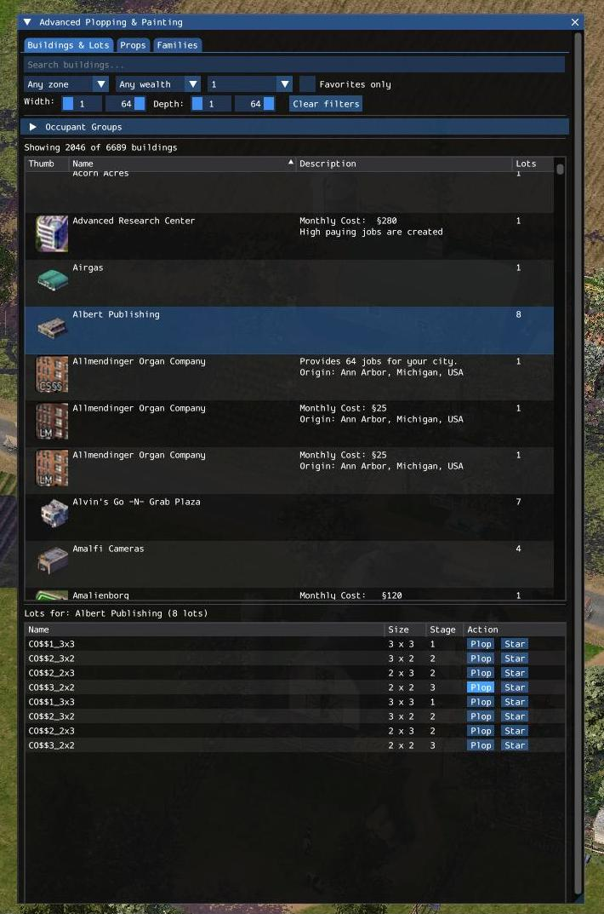
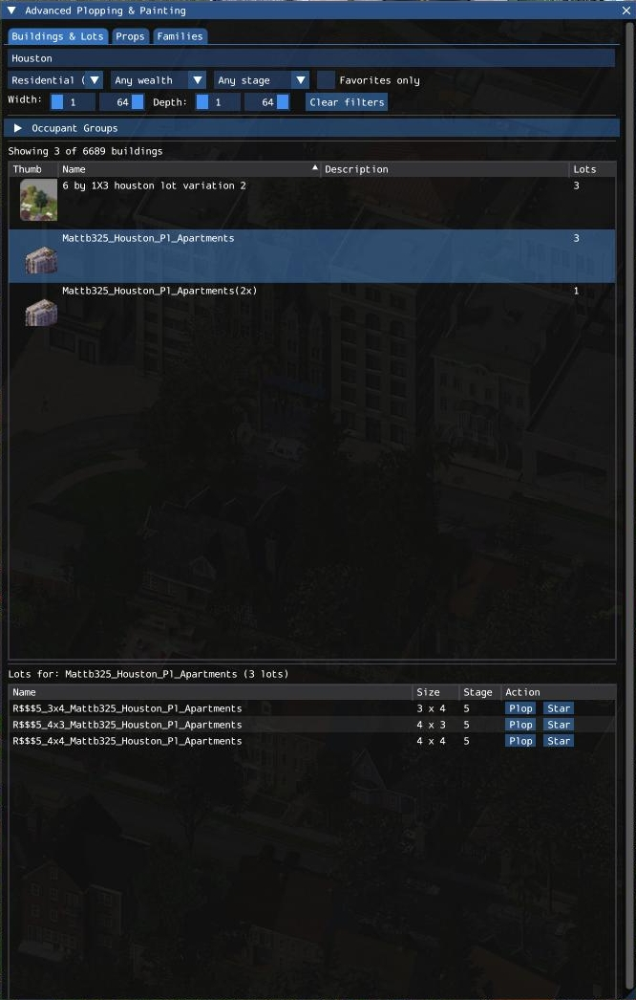
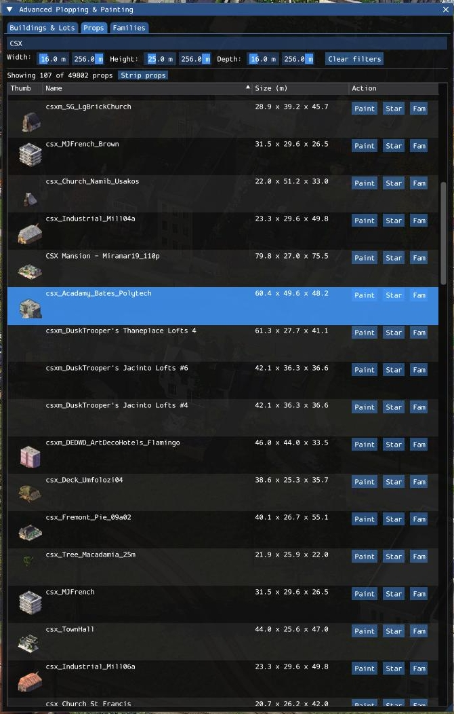
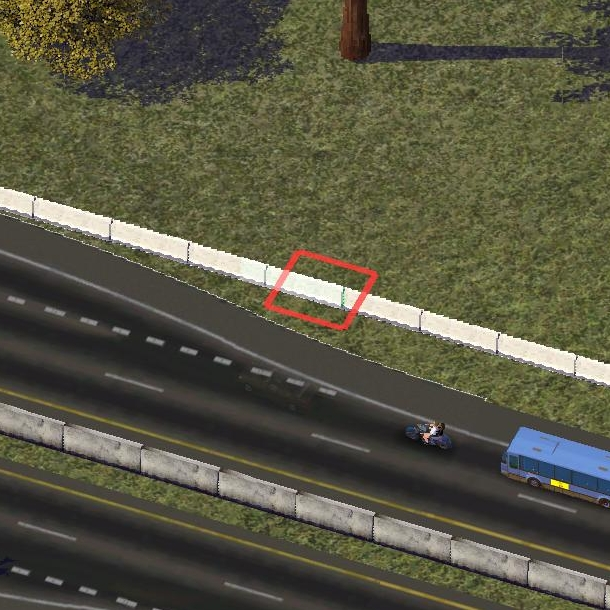
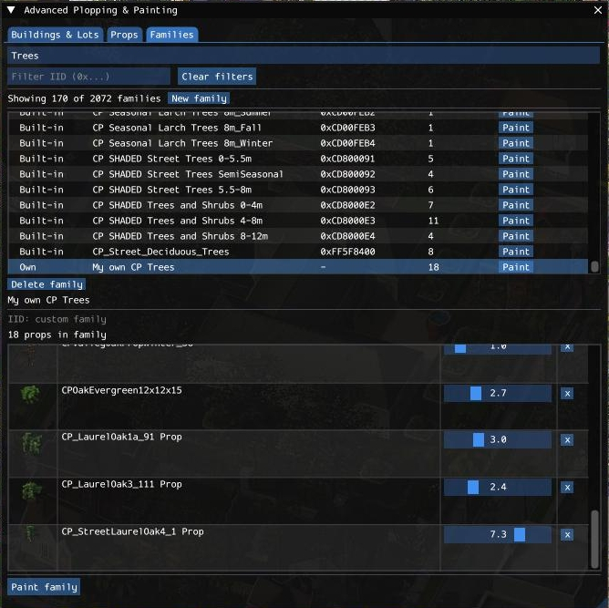
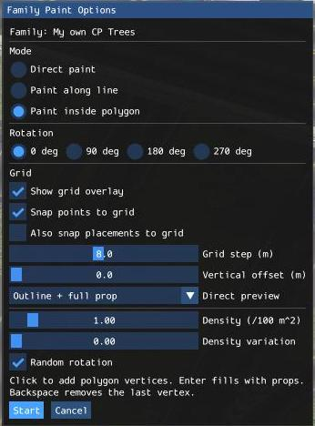
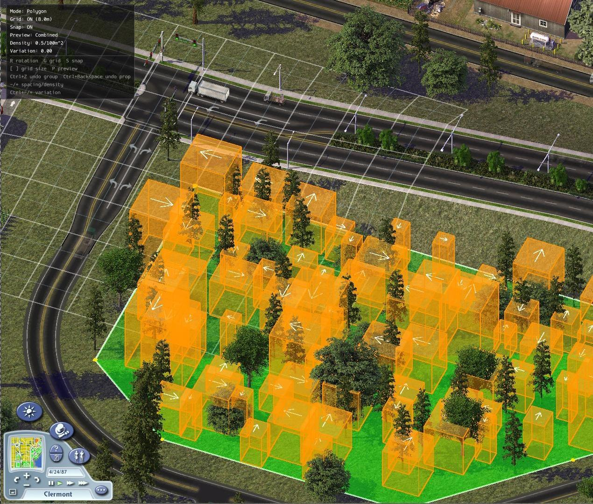
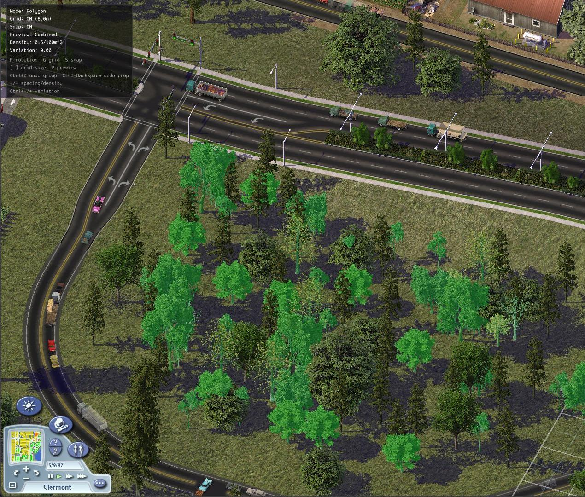
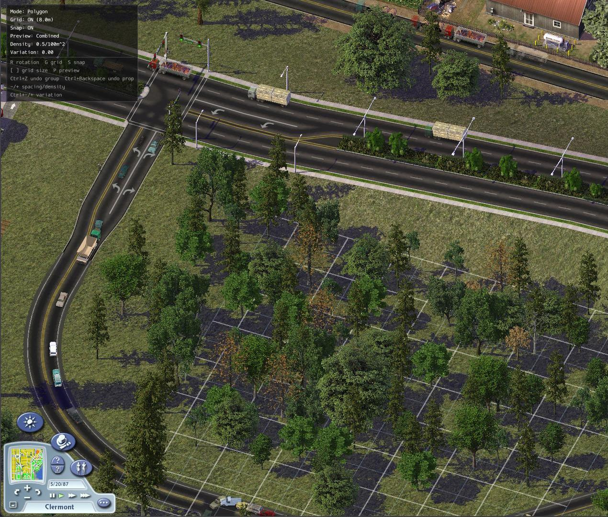

# Using SC4 Plop and Paint In-Game

This guide is written for players, not developers. It covers the full in-game flow after installation and after the cache has been built.

## Before you start

1. Run the cache builder if you have added, removed, or changed plugins.
2. Start SimCity 4 and load a city.
3. Press the panel toggle shortcut to open the `Advanced Plopping & Painting` window. The packaged default is `O`.

If the panel opens but the lists are empty, `Buildings & Lots` is missing `lots.cbor`, `Props` / `Prop Families` are missing `props.cbor`, or `Flora` / `Flora Collections` are missing `flora.cbor`.

The main window can be closed either with the same toggle shortcut or with the window close button.

## The main window

The window has six tabs:

- `Buildings & Lots`: browse buildings and plop lots
- `Props`: browse props, paint a single prop, and remove placed props
- `Prop Families`: manage built-in and custom prop families, then paint with a weighted random palette
- `Flora`: browse individual flora items and paint one flora type at a time
- `Flora Collections`: paint flora families and multi-stage chains built from the loaded flora data
- `Terrain Paint`: paint areas, lines, brush strokes and road markings on the terrain, and stamp texture decals

The main panel with all tabs available in a loaded city.

## Buildings & Lots

This tab is for finding and plopping lots.

Filters:

- `Search buildings...`: matches both building names and lot names
- Zone: `Any zone`, `Residential (R)`, `Commercial (C)`, `Industrial (I)`, `Plopped`, `None`, `Other`
- Wealth: `Any wealth`, `$`, `$$`, `$$$`
- Growth stage: `Any stage`, `Plopped (255)`, `0` through `15`
- Wall-to-wall: `Any W2W`, `W2W only`, `Non-W2W only`
- `Favorites only`
- `Width` and `Depth` min/max sliders
- `Building Styles`: expandable list of styles with `Clear styles`
- `Occupant Groups`: expandable tree filter with `Clear occupant groups`
- `Clear filters`: next to the number of buildings shown, resets all of the above. The line also says how many filters are on, and the `Building Styles` and `Occupant Groups` headers show what is selected while they are closed

Important behavior:

- Filtering is lot-based, but the list shows buildings. A building stays visible if any of its lots matches the current filters.
- The upper table lists buildings. Single-click selects one.
- Double-clicking a building row auto-plops only when that building has exactly one lot.
- The lower table shows the selected building's lots.

Building styles and wall-to-wall buildings:

- Select one or more styles to show the buildings that can use any of them.
- `Compatible with active styles` shows only the buildings with a style that is checked in the game's Building Style Control. Load a city to use this filter.
- A `W2W` pill shows on wall-to-wall buildings.
- Custom styles need the [More Building Styles](https://github.com/0xC0000054/sc4-more-building-styles) DLL. Without this DLL, only the four Maxis styles show, because the game does not read the Building Styles property.
- Industrial buildings without a Building Styles property can use all styles.
- If you built your cache with an older version, run the cache builder again. Until you do, the style and wall-to-wall data is not complete.

Lot actions:

- Double-click a lot row to plop it
- Press `Plop` to plop it
- Use `Star` / `Unstar` to manage lot favorites

The lot browser with filters, building results, and the selected building's lot list.

## Props

This tab is for individual props and prop removal.

Filters:

- `Search props...`, which also matches pack names
- The pack list: only the props of one pack, as the [SC4 Prop Texture Catalog](https://github.com/noah-severyn/SC4PropTextureCatalog) knows them (needs `packs.cbor` from the cache builder). A prop that several packs ship is listed under each of them. Hovering a prop shows its pack.
- `Favorites only`
- Width, height, and depth min/max sliders
- `Clear filters`

Per-prop actions:

- `Paint`: start painting that prop, or switch the active paint tool to that prop if you are already painting
- `Star` / `Unstar`: manage prop favorites
- `...`, or a right-click on the row: add the prop to one of your custom families or to a seasonal set, or make a new family from it
- A click selects a row, and a double-click paints that prop

If you hover a prop name and it belongs to built-in families, the tooltip shows those family IDs and names.

Prop thumbnails reflect the current in-game season when seasonal variants are available.

Scene picking: while in paint mode, you can click an existing prop in the city to switch to painting that prop instead.

Strip mode:

- Use the `City`, `Lot`, and `Street` checkboxes to choose which prop sources are active
- The stripper works on the union of the checked sources
- `Strip props`: enters prop removal mode
- `Stop stripping`: exits strip mode from the tab
- If no source checkbox is enabled, `Strip props` is disabled
- In strip mode, move the cursor over a prop within the preview radius and left-click to delete it
- Press `B` to change between single, brush and polygon mode. The tab shows the current mode
- In brush mode, hold the left mouse button to strip everything inside the preview radius
- In polygon mode, click the corners of an area. Props with their origin inside the area are highlighted. Press `Enter` to remove them, or `Backspace` to remove the last corner. The tab shows how many props are selected. At most 512 are highlighted, but all of them are removed
- `Ctrl+Z` restores the most recently removed city, lot, or street prop. In polygon mode it restores the whole area
- `Esc` clears the polygon, and otherwise exits strip mode. Right-drag pans the camera as usual

The props browser, including `Paint`, favorites, family assignment, and strip mode access.

Strip mode highlights props in the city so you can remove them one by one and undo mistakes.

## Prop Families

This tab combines built-in families from the cache with your own custom families.

Filters and top actions:

- `Search family name...`
- `Filter IID (0x...)`
- `Clear filters`
- `New family`
- `Stop painting` while paint mode is active

Family list:

- `Built-in` families are read-only and show their instance IDs
- `Own` families are your editable custom families
- Double-click a family row or press `Paint` to open the family paint options

Custom family management:

- Create a family with `New family`
- Delete the selected custom family with `Delete family`
- Add props from the `Props` tab using `Fam`
- Adjust entry `Weight` values to bias random selection
- Remove entries with the `x` button

Built-in families cannot be edited.

Custom families let you manage weighted prop palettes before painting with them.

## Flora

This tab is for individual flora items.

Filters:

- `Search flora...`: also matches the pack a flora item comes from
- The pack list: shows only the flora of one pack, as the [SC4 Prop Texture Catalog](https://github.com/noah-severyn/SC4PropTextureCatalog) knows them (from `packs.cbor`). An item in several packs shows under each of them
- `Favorites only`
- `Clear filters`

Per-flora actions:

- `Paint`: start painting that flora item
- `Star` / `Unstar`: manage flora favorites

Important behavior:

- Search also matches flora group and instance IDs in `0x...` form
- Flora painting uses the same paint popup and the same direct, line, and polygon modes as prop painting
- `Place on roads and lots` lets flora stand on roads, buildings, props and other flora
- Flora thumbnails reflect the current in-game season when seasonal variants are available
- While flora painting is active, the tab shows `Stop painting`
- Scene picking: while in flora paint mode, you can click an existing flora item in the city to switch to painting that type

## Flora Collections

This tab is for derived flora collections. These collections are read-only and are built automatically from loaded flora data.

Collection types:

- `Families`: flora families
- `Multi-stage`: flora chains

Filters:

- `Search collection name...`
- `Filter IID (0x...)`
- Type: `All types`, `Families`, `Multi-stage`
- `Favorites only`
- `Clear filters`

Important behavior:

- `Favorites only` shows only collections that contain at least one favorited flora item
- Double-clicking a collection row or pressing `Paint` opens the flora paint options for that collection
- Selecting a collection shows its members below, including thumbnails, IDs, and favorite buttons for the individual flora entries

## Terrain Paint

This tab paints the ground: areas, lines, brush strokes and road markings in any shape, with a ground texture or a plain colour. Everything you paint stays editable and is saved with the city. It needs SC4RenderServices with terrain paint and `EnableCustomTerrainDecalRenderer=true`.

Tools (pick one to start, `Stop` or Esc to end):

- `Area`: click points to outline an area. Click the first point or press Enter to finish. With `Corner radius` the corners are rounded.
- `Line`: click points along a line, Enter to finish. Set the width, flat or round ends, and dashes for road markings.
- `Brush`: hold the left mouse button and drag. With `Join overlapping strokes`, a stroke over one painted the same way becomes part of it, so a patch of ground stays one object in the list.
- `Marking`: road markings. Pick a kind and click the points it needs:
  - `Parking row` and `Car park`: click along the front of the row, Enter to finish. The bays lie to the left of the direction you click in. A car park adds rows back to back with aisles between them.
  - `Zebra crossing`: two clicks across the road, kerb to kerb.
  - `Arrow`: click the tail, then the tip.
  - `Double line`: click along the line, Enter to finish.
  - `Hatching`: click round the area, then click the first point or press Enter. The stripe angle is measured from the first side.
  - `Text`: type the text, click where it starts, then click which way it runs.
- `Erase`: rub out painted ground with a brush, or click an outline and press Enter.
- `Select`: click painted ground to select it (Ctrl+click adds to the selection), drag to move it, Delete to remove it. Shift+drag moves its texture instead of the shape. With one area, line or marking selected, its points show: drag a point to move it, Ctrl+click its path to add a point, Alt+click a point to remove it.
- `Stamp`: the texture decal painter described below.

`Draw` chooses straight lines between clicks, a smooth curve through them, freehand drawing (drag), or the `Pen`. With the pen, a click makes a corner, and if you hold the button and drag you pull out handles that bend the line. Hold `Shift` to turn a handle in 15 degree steps. Hold `Alt` while you drag to bend only the side that comes next, for a sharp change of direction at a curved point. Press on the last point and drag to change its curve. A ring shows on the first point when a click closes the shape. With `Select`, drag a handle to change its curve, and `Alt`+drag a handle to bend only that side. Drag it back onto the point to remove that side. `Join handles` makes a smooth curve again. Click a point, then use `Make curve` or `Make corner`, or `This corner` to round only that corner. Backspace removes the last point, Esc cancels the shape, and a second Esc stops the tool. Right-drag pans the camera, even halfway through a shape. The grid works as in the other painters: G shows it, Shift+S snaps points to it, Ctrl+[ and Ctrl+] change its step.

`Snap to paint` (M) snaps clicked and dragged points to what is already painted: corners, the middles of sides, and edges. After snapping to an edge, a side drawn within 2° of parallel or square to it lines up with it. Hold Shift for 15° steps from the last point. A small ring shows what the point snapped to. The status box shows the length of the side being drawn, how far it turns from the last, and the length and area of the whole shape; with one object selected, its area.

`Paint with`: `Copy look` (or Alt+click in the city) takes the colour or textures and finish from something already painted.

- `Palettes`: named sets of colours and textures that you use together. They are the same in all your cities. `Add this look` adds the colour or the textures that you paint with now. `...` makes a new palette, or renames or deletes this one. Click a tile to paint with it, or right-click a tile to remove it. `Mix all` paints with all textures of the palette as a mix.
- A mix shows as a row of tiles with the share of each. Click a tile to change its share or remove it. With soft patches, `Make base` chooses the texture that covers the shape.
- `Colour`, or `Texture`: pick ground textures from the library below it.
  - Click a texture to paint with it. Ctrl+click adds it to a mix, or takes it out again. In a mix, each 16 m square of ground takes one of the textures, by its share, for natural variation.
  - Right-click a texture to make it a favourite; `Favourites only` shows just those. They are the same favourites as in `Stamp`.
  - `Pack` shows the textures of one pack. With `All packs`, a pack's textures sit together. The search finds textures by the name of the file they first shipped in, their pack, or their instance ID. Pack and file names come from the [SC4 Prop Texture Catalog](https://github.com/noah-severyn/SC4PropTextureCatalog), through `packs.cbor`. Without that file, the search goes by instance ID only.
  - The textures you used last are at the top.
- `Texture size` and `Texture turn` scale and turn the texture. `Texture shift` moves it, to line it up with a kerb or a lot; Shift+drag in `Select` does the same in the city.
- `Mix` (with two or more textures): `By 16 m square`, or `In soft patches`: the first texture covers the shape and the others lie on it in natural, blended patches, each by its share. `Patch size` sets how big they are, `Patch blend` how far their edges fade.
- `Follow the line` (lines with a texture): the texture runs along the line and spans its width, like a dirt track or a kerb. `Texture length` is how often it repeats along the line.
- `Finish`: opacity, a soft edge (how far in from the edge the paint fades out), worn paint (patches missing, as on an old road), a rough edge (an uneven, natural outline that wanders this far in and out, for grass, dirt and gravel; not for markings) and, under `Advanced`, the depth (raise it when the paint flickers or hides under lot textures; 4 and up draws over the game's shadows).

Colour and opacity changes show in the city while the slider moves; changes to the shape show every so often and apply when you let go.

`Painted in this city` lists everything painted, top first: show or hide it, lock it against erasing and moving, and click a row to select it. With one object selected, its name, shape settings and look can be changed; changes apply when you let go of a control. `Up`, `Down`, `Top` and `Bottom` change what lies on top. With the selection:

- `Turn` and `Scale`: drag to turn or scale it about its middle; it changes when you let go.
- `Copy` (Ctrl+D): copies it, 4 m away.
- `Group` (Ctrl+G) and `Ungroup` (Ctrl+Shift+G): a group is selected as one.
- `Merge`: makes it one shape, painted like the topmost. Its points can no longer be edited.
- `Border, repeat, mirror`:
  - `Add border`: a new shape along the edge, outside, inside or on it, such as a kerb, a gravel edge or a beach. It starts painted the same way; pick its own look next.
  - `Repeat`: copies across and down, each a `Step` further (it starts just clear of the selection). Groups are copied as groups.
  - `Flip left-right` and `Flip top-bottom` mirror it. Parking bays and turn arrows swap sides, text is not written backwards. With `as a copy`, the original stays and the copy lies alongside it.
- `Props and flora on it`: with the prop, family or flora you painted last, `Fill it` opens its painter in Polygon mode with this shape as the sketch (holes stay empty), and `Plant along it` opens it in Line mode along this line or round the edge of this shape. Then -/+ change the density or spacing, and Enter places them. In the Line and Polygon modes of the prop and flora painters, F over painted ground does the same.

Ctrl+Z and Ctrl+Y undo and redo, in the panel and in the city.

Shortcuts, by key and with a mouse that has a middle and back/forward buttons:

| Action | Key | Mouse |
|---|---|---|
| Undo, redo | Ctrl+Z, Ctrl+Y | Back, Forward |
| Remove the last point while drawing | Backspace | Back |
| Finish the shape | Enter | Middle click |
| Brush or eraser size | `[` and `]` | Middle-drag sideways |
| Turn the selection | `,` and `.` (15°, with Shift 1°) | Middle-drag sideways |
| Scale the selection | `-` and `=` | Shift + middle-drag sideways |
| Snap to paint on or off | M | |
| 15° steps from the last point | Hold Shift | |

### Stamp

Stamp paints single texture decals on terrain and lot surfaces.

Filters:

- `Search decals...`
- `Favorites only`
- `Clear filters`

Per-decal actions:

- `Paint`: start painting that decal
- `Star` / `Unstar`: manage decal favorites

Paint options specific to decals:

- `Rotation`: continuous rotation (any angle, not limited to 90-degree steps)
- `UV offset`: adjust the texture offset within the decal
- `Depth offset`: raise or lower the decal surface relative to terrain
- `Mirror`: flip the decal horizontally

Favorites for decals also save the current paint settings as a preset, so reopening a favorited decal restores the rotation, UV, and depth values you last used with it.

Pickers:

- **Scene pick**: click an existing decal in the city to switch to painting that decal
- **Lot texture pick**: click a lot surface to use its texture as the decal source
- **Lot pick**: click a lot to use its associated decal

## Favorites

Favorites are there to reduce repeated searching.

In `Buildings & Lots`, press `Star` on a lot to save it and `Unstar` to remove it. Turning on `Favorites only` limits the visible list to your saved lot favorites that still match the other filters.

In `Props`, `Star`, `Unstar`, and `Favorites only` work the same way for props.

In `Flora`, `Star`, `Unstar`, and `Favorites only` work the same way for individual flora. In `Flora Collections`, `Favorites only` filters collections by whether they contain any flora you have favorited.

Favorites are stored by the plugin and persist between sessions.

## Creating and managing your own families

Custom families are your own weighted random prop palettes.

To create one, open `Prop Families`, press `New family`, enter a name, and press `Create`. The new family starts empty.

The fastest way to add props to a family is from the `Props` tab: find a prop, press `Fam`, and choose the destination family from the popup. Once a family has members, return to `Prop Families` to review and edit it.

When a custom family is selected, you can delete it, change each entry's weight, and remove individual entries with the `x` button. Higher weights make an entry more likely to be chosen during family painting.

Built-in families (i.e. provided by Maxis or custom content creators) are read-only. Custom families are editable.

## Starting paint mode

Painting can be started from the `Props` tab for a single fixed prop, from the `Prop Families` tab for a weighted random prop family, from the `Flora` tab for a single flora type, or from `Flora Collections` for a flora family or multi-stage chain. Before the tool activates, a popup lets you choose the paint settings.

Common options:

- `Mode`: `Direct paint`, `Paint along line`, or `Paint inside polygon`
- `Rotation`: fixed 0 / 90 / 180 / 270 degrees
- `Show grid overlay`: shows the preview grid on the terrain
- `Snap points to grid`: snaps the points you click to the grid
- `Also snap placements to grid`: snaps final placed props to the grid as well
- `Grid step (m)`: grid size in meters. Dragging moves in 0.5 m steps, the buttons set 2, 4, 8 or 16 m, and Ctrl+click takes any value. The size you last chose is kept, also after a restart, and so are `Show grid overlay` and `Snap points to grid`: one set for props and prop families, one for flora and flora collections, one for decals and one for terrain paint
- `Vertical offset (m)`: raises placed props and the preview above the terrain
- `Preview`: `Outline only`, `Full model only`, or `Outline and model`

Mode-specific options:

- Line mode: `Spacing (m)` (moves in 0.5 m steps, with the same buttons and Ctrl+click), `Align to path direction`, `Random rotation`, and `Lateral jitter (m)`
- Polygon mode: `Fill` is `Scatter` (`Density (/100 m^2)`, `Density variation`) or `Rows` (`Row spacing`, `Step along row`, `Row angle`, `Turn items with the rows`), and both have `Edge margin` and `Random rotation`. With `Rows`, `-` and `+` change the row spacing, and `Ctrl` with `-` or `+` changes the step along the row

Polygon notes:

- `Density` currently ranges from `0.1` to `10.0` per `100 m^2`
- `Density variation` ranges from `0.0` to `1.0`
- `Density variation` controls how uniform or patchy the fill looks: `0` is more even, `1` creates more clusters and gaps

When painting with a prop family, each placed prop is chosen from that family using its saved weights.

When painting flora, placements use flora exemplars instead of prop occupants, but the painting flow and hotkeys are intentionally kept close to prop painting.

The paint options popup, shown here in polygon mode with density and density variation controls.

## How the paint tool works

After you press `Start`, the paint tool takes over map input until you commit or cancel.

In `Direct paint`, left-click places one prop at a time.

In `Paint along line`, left-click adds line points and `Enter` places props along the path.

In `Paint inside polygon`, left-click adds polygon vertices and `Enter` fills the area.

With ground painted in the `Terrain Paint` tab, `F` takes its shape as the sketch: in `Paint inside polygon` the shape under the cursor is filled (holes in it stay empty), in `Paint along line` the props follow a painted line, or go round the edge of a painted area.

In line and polygon modes, the first `Enter` generates the batch and places it as pending props. Press `Enter` again to commit those pending props permanently.

Polygon paint mode in action, with the live overlay preview and the status window visible on the map.

## Paint tool controls

While paint mode is active:

- `R` or a middle click: rotate the fixed rotation (cycles 0 / 90 / 180 / 270)
- `G`: toggle the grid overlay
- `Shift+S`: toggle point snapping (turning it off also disables placement snapping)
- `Ctrl+[` / `Ctrl+]`: step the grid size through preset values (`1`, `2`, `4`, `8`, `16` meters)
- `P`: cycle preview mode (`Outline`, `Full`, `Combined`, `Hidden`)
- `Backspace`: remove the last unconfirmed line point or polygon vertex while drawing
- `Ctrl+Z` or the back mouse button: undo the whole last pending placement group
- `Ctrl+Backspace`: undo only the last prop in the current top group
- `Enter`: place the current line or polygon batch, or commit pending placements
- `Esc`: cancel the line or polygon being drawn; with none, cancel all pending placements and leave paint mode
- Right-drag pans the camera as usual, also while drawing a line or polygon

Flora-specific note:

- Depending on the flora type and in-game placement rules, some preview positions may be rejected and will not place

Mode-specific hotkeys:

- Line mode: `-` / `+` decrease or increase spacing by `0.5m`
- Polygon mode: `-` / `+` decrease or increase density by `0.25`
- Polygon mode: `Ctrl+-` / `Ctrl++` decrease or increase density variation by `0.05`
- Line and polygon modes: `F` takes the shape of the painted ground under the cursor as the sketch

While painting, a small status window also shows up to help you out and to mirror the main paint hotkeys for quick reference.

## What "pending placements" means

Painted props are first placed in a temporary highlighted state. They are visible immediately, but they are still considered pending until you commit them. While they are pending, you can undo them. Press `Enter` to commit everything currently pending, or press `Esc` to remove all pending placements instead.

That means even in direct mode there are usually two stages: you click to place one or more props, then you press `Enter` when you are satisfied and want to make them final.

## Typical flows

**Plop a lot**

1. Press the panel toggle shortcut (default `O`).
2. Open `Buildings & Lots`.
3. Filter until you find the building or lot you want.
4. Double-click the lot row or press `Plop`.

**Paint one prop repeatedly**

1. Press the panel toggle shortcut (default `O`).
2. Open `Props`.
3. Find the prop and press `Paint`.
4. Choose `Direct paint` or another mode and set the options you want.
5. Press `Start`.
6. Click to place props.
7. Use `Ctrl+Z` or `Ctrl+Backspace` if needed.
8. Press `Enter` to commit, or `Esc` to cancel.

**Paint a row of props**

1. Start from `Props`, `Prop Families`, `Flora`, or `Flora Collections`.
2. Choose `Paint along line`.
3. Press `Start`.
4. Click each control point along the line.
5. Press `Enter` to generate the placements.
6. Press `Enter` again to commit them, or undo or cancel instead.

**Paint a filled area**

1. Start from `Props`, `Prop Families`, `Flora`, or `Flora Collections`.
2. Choose `Paint inside polygon`.
3. Set `Density`, `Density variation`, and any other options you want.
4. Press `Start`.
5. Click each polygon vertex.
6. Press `Enter` to fill the area.
7. Press `Enter` again to commit, or use undo if needed.

**Paint a random family**

1. Open `Prop Families`.
2. Select or create a family.
3. Adjust the family weights if needed.
4. Press `Paint family`.
5. Choose a mode and options.
6. Paint as normal; each placement will be chosen from the family.

## Example use cases

**Replace repeated manual lot searching**

If you keep using the same transit, utility, landmark, or decoration lots:

1. Find them once in `Buildings & Lots`.
2. Mark them with `Star`.
3. Turn on `Favorites only` later when you want a short working list.

This is useful when your Plugins folder is large and you want a compact set of go-to lots.

**Plop lots that are normally only seen as growables**

The lot browser is useful even when you are not sure how a building is normally obtained in gameplay:

1. Open `Buildings & Lots`.
2. Filter by zone, wealth, growth stage, size, or occupant groups.
3. Find a lot that would normally only appear as a growable.
4. Double-click it or press `Plop` to place it directly.

This makes it easier to use growable-content lots intentionally in custom cities, test setups, or showcase regions.

**Discover content you forgot you installed**

The browsing tabs can also be used as a discovery tool:

1. Open `Buildings & Lots`, `Props`, `Prop Families`, `Flora`, or `Flora Collections`.
2. Search loosely by theme, size, or category instead of by exact name.
3. Browse thumbnails, family tooltips, and filtered lists.
4. Use `Star` to save anything you want to come back to later.

This is useful when you have a large Plugins collection and want to rediscover buildings, lots, or props you did not remember having.

**Lay out fences, hedges, or roadside details quickly**

Use `Paint along line` when you want a clean repeated sequence along a street, path, or lot edge:

1. Start from `Props`, `Prop Families`, `Flora`, or `Flora Collections`.
2. Choose `Paint along line`.
3. Set `Spacing`, `Align to path direction`, and optional `Lateral jitter`.
4. Click the control points along the route.
5. Press `Enter` to generate the row, then `Enter` again to commit.

This works well for fences, bollards, lamps, benches, and other evenly spaced props.

**Place road signs, highway signs, or sound barriers along a route**

Line paint is also useful for transportation detailing where orientation and spacing matter:

1. Start from `Props` / `Flora` for one repeated asset, or `Prop Families` / `Flora Collections` for a small themed set.
2. Choose `Paint along line`.
3. Turn on `Align to path direction`.
4. Adjust `Spacing` until the preview matches the rhythm you want.
5. Click along the road, ramp, or highway edge.
6. Press `Enter` to generate the run, then `Enter` again to commit.

This is a good fit for roadside signs, gantry-adjacent details, retaining props, and repeated sound barriers.

**Fill parks, medians, or vacant corners with less repetitive clutter**

Use `Paint inside polygon` when you want to cover an area instead of drawing a single line:

1. Start from `Props` / `Flora` for one repeated item, or `Prop Families` / `Flora Collections` for a mixed palette.
2. Set `Density` for overall coverage.
3. Set `Density variation` higher if you want more natural clumps and gaps.
4. Click the polygon outline.
5. Press `Enter` to generate the fill, then `Enter` again to commit.

This is the fastest way to block in planters, shrubs, rocks, debris, or plaza furniture across an irregular shape.

**Dress up industrial or port areas with mixed clutter**

Custom families and polygon fill work well for cargo-heavy scenes:

1. Create a family for containers, pallets, crates, drums, or similar props.
2. Add matching entries from the `Props` tab with `Fam`.
3. Raise the `Weight` of the props you want to dominate the mix.
4. Start painting from `Prop Families` with `Paint inside polygon`.
5. Tune `Density` and `Density variation` until the preview looks believable.
6. Fill warehouse yards, loading areas, docks, or fenced industrial corners.

This is an efficient way to create busy-looking industry and port spaces without hand-placing every single object.

**Build a reusable random palette for one theme**

If you often place the same style of clutter together, create a custom family:

1. Create a family in `Prop Families`.
2. Add matching props from the `Props` tab with `Fam`.
3. Increase the `Weight` of the props you want to appear more often.
4. Paint with that family in direct, line, or polygon mode.

This is useful for themed sets like street furniture, industrial clutter, plaza details, or shoreline props.

**Remove mistakes without restarting the whole pass**

When painting or stripping, you do not need to stop and start over for small corrections:

1. While painting, use `Ctrl+Z` to remove the most recent group, or `Ctrl+Backspace` to trim the last prop from that group.
2. While stripping, use `Ctrl+Z` to restore the most recently removed city, lot, or street prop.
3. Use `Esc` if you want to abandon the current paint batch or leave strip mode.

This makes it practical to work iteratively instead of treating each pass as all-or-nothing.

## Stopping paint mode

## INI options

The packaged `SC4PlopAndPaint.ini` controls several runtime defaults.

Relevant options:

- `EnableDrawOverlay`: disables the in-city preview (grid, outlines and placement boxes) if needed
- `DefaultPropPreviewMode`: `outline`, `full`, or `combined`. The default is `full`, which shows the models. An outline still shows for items without a model.
- `DefaultShowGridOverlay`, `DefaultSnapPointsToGrid`, `DefaultSnapPlacementsToGrid`, `DefaultGridStepMeters`: default paint popup values
- `ThumbnailDisplaySize`: thumbnail size in the UI (`22` to `220`). The cache stores thumbnails at the size given to the cache builder (`--thumbnail-size`, default `132`); larger ones are scaled down to this size
- `ThumbnailBackgroundColor` and `ThumbnailBorderColor`: thumbnail slot colors shown behind transparent thumbnails

Thumbnail color options accept `RRGGBB` or `RRGGBBAA`. Set either one to an empty value to make it transparent.

## Stopping paint mode

Press `Esc` to cancel pending placements and leave paint mode immediately. If you reopen the panel while painting, the `Props`, `Prop Families`, `Flora`, and `Flora Collections` tabs also show a `Stop painting` button.
